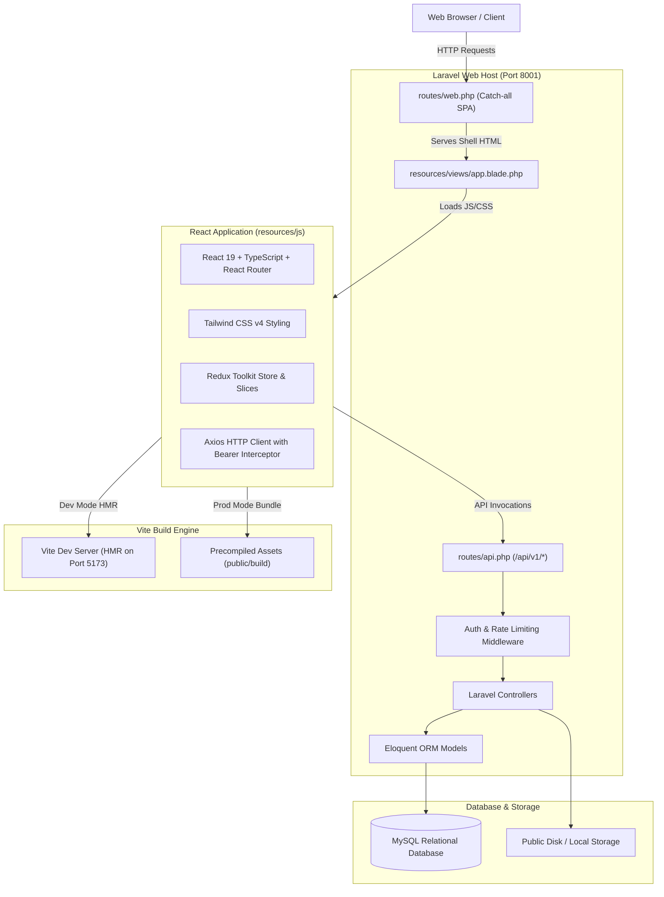
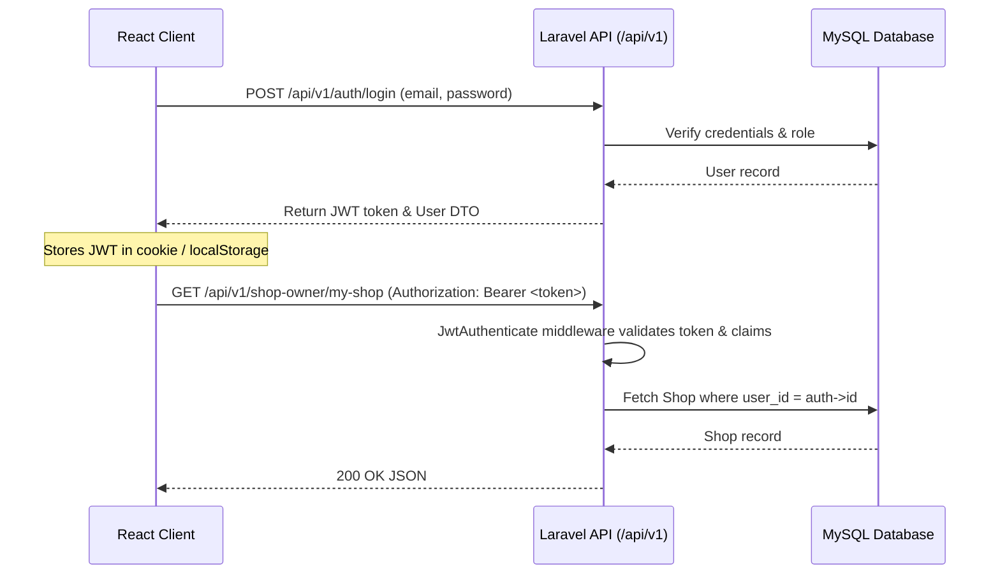

# Architecture Overview

This project employs a **Modern Monolithic Architecture** where a high-performance **Laravel 12 (PHP 8.3)** backend orchestrates database operations, security, and business logic, while delivering a rich client-side single page application built with **React 19** and **TypeScript**.

---

## 1. System Topology

---

## 2. Monolithic Integration Model

Instead of running separate decoupled servers with complex CORS, session, and deployment overheads, this monolith unifies the codebase:

1. **Single Repository & Dependency Tree:**
   - Root [package.json](file:///c:/Sushil%20Hemrom/explore/small-e-commerce/package.json) manages frontend dependencies.
   - Root [composer.json](file:///c:/Sushil%20Hemrom/explore/small-e-commerce/composer.json) manages PHP backend packages.
2. **Laravel Vite Integration:**
   - Handled via [vite.config.ts](file:///c:/Sushil%20Hemrom/explore/small-e-commerce/vite.config.ts) utilizing `laravel-vite-plugin`, `@vitejs/plugin-react`, and `@tailwindcss/vite`.
   - In **development**, `@viteReactRefresh` and `@vite(['resources/js/main.tsx'])` point to the Vite development server on `http://127.0.0.1:5173` for instant Hot Module Replacement (HMR).
   - In **production**, Laravel automatically falls back to [public/build/manifest.json](file:///c:/Sushil%20Hemrom/explore/small-e-commerce/public/build/manifest.json) to serve minified, hashed bundles directly without needing Node.js in production.
3. **Client-Side Routing Integration:**
   - In [routes/web.php](file:///c:/Sushil%20Hemrom/explore/small-e-commerce/routes/web.php), a fallback catch-all route renders [resources/views/app.blade.php](file:///c:/Sushil%20Hemrom/explore/small-e-commerce/resources/views/app.blade.php) for any route not prefixed with `api/` or reserved system paths like `/health`.
   - **React Router** in [resources/js/routes/index.tsx](file:///c:/Sushil%20Hemrom/explore/small-e-commerce/resources/js/routes/index.tsx) takes over client routing seamlessly.

---

## 3. Security & Role-Based Access Control (RBAC)

The system enforces three clear security roles defined by [`UserRole`](file:///c:/Sushil%20Hemrom/explore/small-e-commerce/app/Enums/UserRole.php):

| Role | Identifier | Permitted Access Scope |
|---|---|---|
| **Administrator** | `admin` | Full system access: manage all shops, shop owners, shared product catalog, and global analytics |
| **Shop Owner** | `shop_owner` | Portal access: manage their assigned shop, browse shared catalog, add items to shop with custom price/details/thumbnail, and create new catalog items |
| **Customer** | `customer` / Public | Public browsing: access shop directories and individual shop storefronts, seeing only products assigned to the active shop |

### Authentication Pipeline

- **Backend Protection:** Routes are guarded by `jwt.auth:{role}` middleware (`JwtAuthenticate`), rejecting unauthorized or role-mismatched requests with standardized JSON responses.
- **Frontend Protection:** React route guards ([resources/js/routes/private/index.tsx](file:///c:/Sushil%20Hemrom/explore/small-e-commerce/resources/js/routes/private/index.tsx)) check the authenticated user's role and redirect unauthorized visitors to `/auth/login` or their authorized home route.
- **API Communication:** The Axios client in [resources/js/hooks/use-api/index.ts](file:///c:/Sushil%20Hemrom/explore/small-e-commerce/resources/js/hooks/use-api/index.ts) automatically attaches the bearer token from cookies and intercepts `401 Unauthorized` responses to clear invalid sessions and redirect to login.

