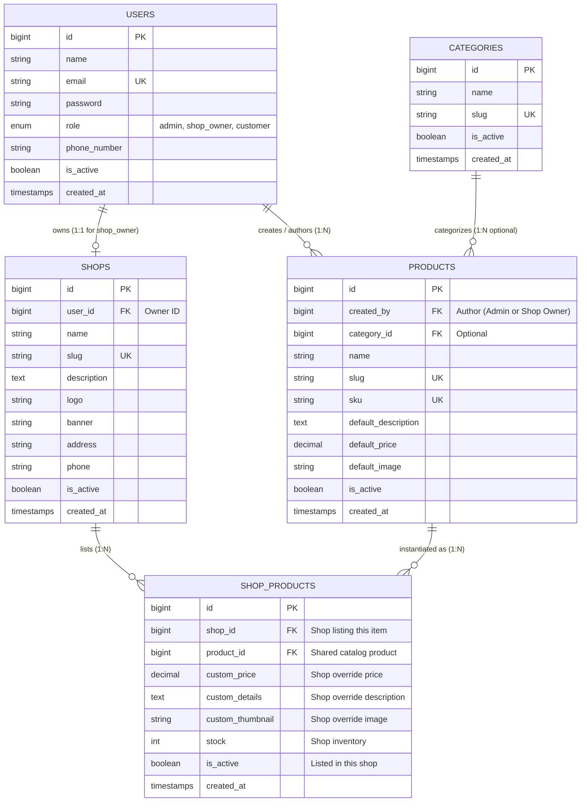

# Database Schema & Data Modeling

This document details the relational data model for the Small E-Commerce Management System. The design supports a **shared global catalog** while granting **independent per-shop customizations** and **strict customer isolation**.

---

## 1. Entity-Relationship Diagram (ERD)



---

## 2. Table Specifications

### A. `users` Table
Stores authentication credentials and user profile information.

| Column | Type | Constraints | Description |
|---|---|---|---|
| `id` | `BIGINT UNSIGNED` | Primary Key, Auto Increment | Unique user identifier |
| `name` | `VARCHAR(255)` | NOT NULL | User's full name |
| `email` | `VARCHAR(255)` | UNIQUE, NOT NULL | User's email address |
| `password` | `VARCHAR(255)` | NOT NULL | Hashed password (Bcrypt) |
| `role` | `VARCHAR(50)` | NOT NULL, Default: `'customer'` | User role: `'admin'`, `'shop_owner'`, `'customer'` |
| `phone_number` | `VARCHAR(50)` | Nullable | Contact phone number |
| `is_active` | `BOOLEAN` | Default: `true` | Account active state |
| `created_at` / `updated_at` | `TIMESTAMP` | Nullable | Audit timestamps |

---

### B. `shops` Table
Stores store entities managed by Administrators and operated by Shop Owners.

| Column | Type | Constraints | Description |
|---|---|---|---|
| `id` | `BIGINT UNSIGNED` | Primary Key, Auto Increment | Unique shop identifier |
| `user_id` | `BIGINT UNSIGNED` | Foreign Key (`users.id`), CASCADE | ID of the shop owner managing this shop |
| `name` | `VARCHAR(255)` | NOT NULL | Store brand name (e.g. "Apex Gadgets") |
| `slug` | `VARCHAR(255)` | UNIQUE, NOT NULL | URL-friendly identifier for customer routing |
| `description` | `TEXT` | Nullable | Store description / about |
| `logo` | `VARCHAR(255)` | Nullable | Store logo file path or URL |
| `banner` | `VARCHAR(255)` | Nullable | Store header banner image |
| `address` | `VARCHAR(255)` | Nullable | Physical location |
| `phone` | `VARCHAR(50)` | Nullable | Store contact telephone |
| `is_active` | `BOOLEAN` | Default: `true` | Store status (active/suspended) |
| `created_at` / `updated_at` | `TIMESTAMP` | Nullable | Audit timestamps |

---

### C. `products` Table (Shared Master Catalog)
Stores the shared master product catalog accessible to all shop owners.

| Column | Type | Constraints | Description |
|---|---|---|---|
| `id` | `BIGINT UNSIGNED` | Primary Key, Auto Increment | Unique catalog product ID |
| `created_by` | `BIGINT UNSIGNED` | Foreign Key (`users.id`), RESTRICT | Creator user ID (Admin or Shop Owner) |
| `category_id` | `BIGINT UNSIGNED` | Foreign Key (`categories.id`), Nullable | Master category |
| `name` | `VARCHAR(255)` | NOT NULL | Product title |
| `slug` | `VARCHAR(255)` | UNIQUE, NOT NULL | Product slug identifier |
| `sku` | `VARCHAR(100)` | UNIQUE, NOT NULL | Stock Keeping Unit identifier |
| `default_description` | `TEXT` | Nullable | Master description |
| `default_price` | `DECIMAL(10, 2)` | NOT NULL | Suggested master catalog price |
| `default_image` | `VARCHAR(255)` | Nullable | Master thumbnail image |
| `is_active` | `BOOLEAN` | Default: `true` | Global catalog visibility flag |
| `created_at` / `updated_at` | `TIMESTAMP` | Nullable | Audit timestamps |

---

### D. `shop_products` Table (Per-Shop Custom Overrides)
Links a shop to a shared catalog product and stores shop-specific overrides.

| Column | Type | Constraints | Description |
|---|---|---|---|
| `id` | `BIGINT UNSIGNED` | Primary Key, Auto Increment | Listing record ID |
| `shop_id` | `BIGINT UNSIGNED` | Foreign Key (`shops.id`), CASCADE | Shop offering this product |
| `product_id` | `BIGINT UNSIGNED` | Foreign Key (`products.id`), CASCADE | Catalog product origin |
| `custom_price` | `DECIMAL(10, 2)` | Nullable | Shop-specific price override |
| `custom_details` | `TEXT` | Nullable | Shop-specific details/description override |
| `custom_thumbnail` | `VARCHAR(255)` | Nullable | Shop-specific image override |
| `stock` | `INT` | Default: `0` | Shop-specific inventory quantity |
| `is_active` | `BOOLEAN` | Default: `true` | Visibility in this specific shop |
| `created_at` / `updated_at` | `TIMESTAMP` | Nullable | Audit timestamps |

> [!IMPORTANT]
> **Unique Composite Key:** An index on `['shop_id', 'product_id']` prevents a shop from listing the same master catalog product more than once.

---

## 3. Data Fallback Resolution

When displaying a shop product in the customer storefront, the system resolves fields hierarchically:

```php
// Effective Price: Shop override if present, otherwise default catalog price
$displayPrice = $shopProduct->custom_price ?? $product->default_price;

// Effective Details: Shop override if present, otherwise default catalog description
$displayDetails = $shopProduct->custom_details ?? $product->default_description;

// Effective Thumbnail: Shop override if present, otherwise default catalog image
$displayThumbnail = $shopProduct->custom_thumbnail ?? $product->default_image;
```

---

## 4. Indexing & Optimization Strategy

1. **Customer Query Performance:**
   - Index on `shop_products(shop_id, is_active)`: Accelerates the primary customer query:
     ```sql
     SELECT * FROM shop_products WHERE shop_id = ? AND is_active = 1
     ```
2. **Slug Lookups:**
   - Index on `shops(slug)`: Enables $O(1)$ routing for URLs like `/shops/tech-haven`.
   - Index on `products(slug)`: Enables fast catalog searching and item lookup.
3. **Foreign Key Integrity:**
   - `ON DELETE CASCADE` on `shop_products`: If an admin deletes a shop, all of its listings are automatically cleaned up without leaving orphan rows.

