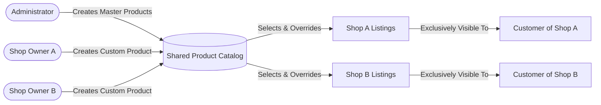

# Small E-Commerce Management System — Documentation

Welcome to the technical documentation for the **Small E-Commerce Management System**. This system is built using a modern **Monolithic Architecture** combining a **Laravel 12 (PHP 8.3)** backend with a **React 19 (TypeScript)** single-page application frontend served via Vite.

---

## 📚 Documentation Index

| Document | Description |
|---|---|
| [**Architecture Overview**](file:///c:/Sushil%20Hemrom/explore/small-e-commerce/docs/architecture.md) | High-level system architecture, monolithic bundling, security, and authentication model |
| [**Database Schema & Data Model**](file:///c:/Sushil%20Hemrom/explore/small-e-commerce/docs/database-schema.md) | Relational database design, Entity-Relationship Diagram (ERD), table structures, and constraints |
| [**Shared Catalog System**](file:///c:/Sushil%20Hemrom/explore/small-e-commerce/docs/shared-catalog-system.md) | Deep dive into the core feature: shared product pooling and shop-specific overrides (price, details, thumbnail) |
| [**API Specification**](file:///c:/Sushil%20Hemrom/explore/small-e-commerce/docs/api-specification.md) | Complete RESTful API documentation for Admin, Shop Owner, and Public Customer endpoints |
| [**Setup & Installation Guide**](file:///c:/Sushil%20Hemrom/explore/small-e-commerce/docs/setup-guide.md) | Step-by-step developer guide for fresh clone, configuration, migrations, seeders, and running both servers |
| [**Candidate Evaluation Checklist**](file:///c:/Sushil%20Hemrom/explore/small-e-commerce/docs/evaluation-checklist.md) | Requirements verification matrix mapped to the candidate assignment specifications |

---

## 🎯 Project Overview & Objective

The objective of this application is to solve multi-vendor catalog isolation by creating a **collaborative shared catalog** while preserving **storefront autonomy**:

### Core Actors:
1. **Administrator:**
   - Authenticates to a protected Admin dashboard.
   - Manages shops (CRUD) and assigns designated Shop Owners.
   - Manages Shop Owner accounts (CRUD).
   - Manages master products in the shared product catalog (CRUD).
2. **Shop Owner:**
   - Authenticates to their Shop Owner portal.
   - Browses the shared master catalog (containing products added by Admin and other Shop Owners).
   - Adds shared catalog products to their own shop.
   - Sets shop-specific overrides: custom pricing, custom descriptions/details, and custom thumbnail images.
   - Can also author new products, which automatically populate their shop **and** contribute back to the shared catalog for peers to adopt.
3. **Customer:**
   - Browses available shops.
   - Accesses shop-specific storefronts displaying **only** products assigned to that particular shop.
   - Sees the shop's customized pricing, details, and thumbnails.
   - **Strict isolation rule:** Unassigned shared catalog products are never visible to customers.

