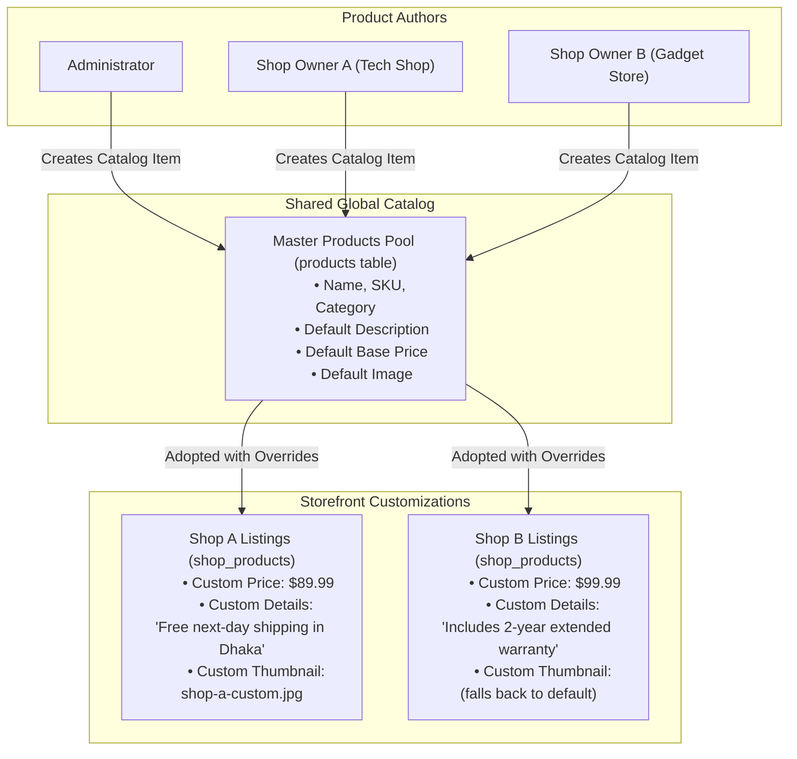
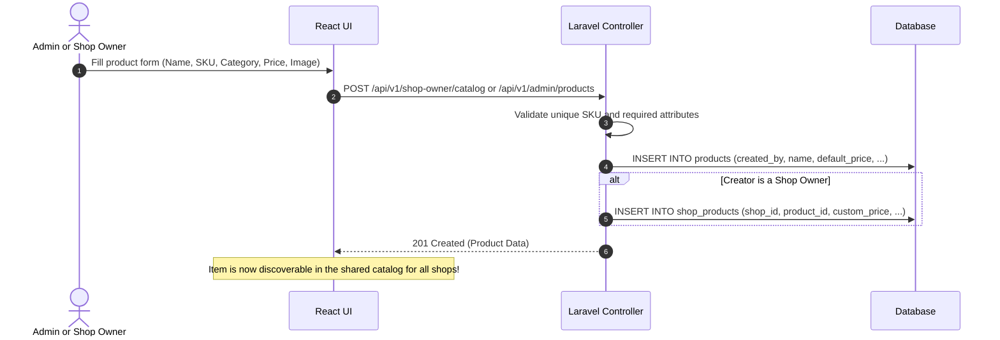
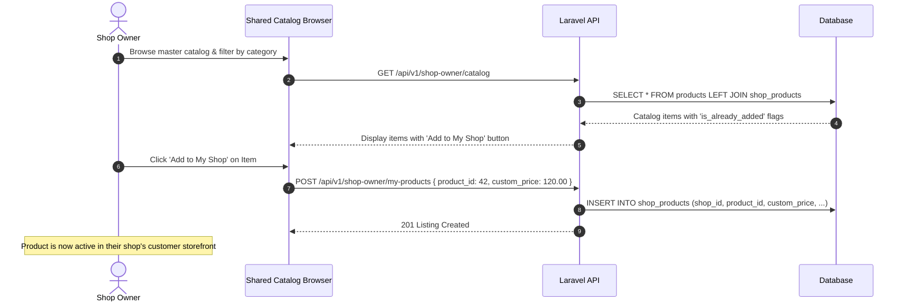

# The Shared Catalog System

The **Shared Product Catalog** is the central mechanism of the Small E-Commerce Management System. It enables collaborative catalog building while maintaining independent store identity, pricing, and merchandising autonomy.

---

## 1. Core Principles



1. **Two-Tier Architecture:**
   - **Tier 1 — Master Catalog (`products`):** Contains the foundational product identity (SKU, title, category, default specifications, and default base price).
   - **Tier 2 — Shop Listings (`shop_products`):** The storefront instance containing store-level merchandising decisions (selling price, custom sales pitch, custom photography, local stock, and active status).
2. **Collaborative Contribution:**
   - Both Administrators and Shop Owners can author new products.
   - Any product created by a Shop Owner is automatically shared with the master catalog so other shop owners can discover and list it too.
3. **Strict Customer Scoping:**
   - Customers interact strictly with **Tier 2**. If a product exists only in Tier 1 (master catalog) but has not been listed by a shop, no customer URL or query will expose it.

---

## 2. Workflows & Lifecycles

### Workflow A: Adding an Item to the Catalog



---

### Workflow B: A Shop Owner Adopts an Existing Product



---

### Workflow C: Setting Shop-Specific Overrides

A shop owner can personalize any product in their shop without altering the master catalog:

| Field | Master Catalog Default | Shop A Override | Shop B Override |
|---|---|---|---|
| **SKU** | `AUD-HD-500` | Inherited (`AUD-HD-500`) | Inherited (`AUD-HD-500`) |
| **Product Title** | Sony WH-1000XM5 | Inherited | Inherited |
| **Selling Price** | `$399.00` | **`$379.00` (Discounted)** | **`$420.00` (With Bundle)** |
| **Product Details** | Factory standard specs | *"Includes 1 year official warranty and carrying pouch."* | *"Includes 2-year store warranty and audio adapter."* |
| **Thumbnail** | White background stock photo | **Custom photo showing shop retail packaging** | Standard stock photo (inherited) |
| **Stock Level** | N/A | **12 units** | **5 units** |

---

## 3. Customer Visibility & Scoping Rule

To satisfy the strict customer view requirement:

> *"Customers should only see products assigned to a shop. Display shop-specific product information, prices, and thumbnails. Products that are not assigned to any shop must not be visible to customers."*

The backend enforces this logic at the query level:

```php
public function getShopProducts(Request $request, string $shopSlug): JsonResponse
{
    $shop = Shop::where('slug', $shopSlug)
        ->where('is_active', true)
        ->firstOrFail();

    // Query strictly through the shop_products pivot
    $products = ShopProduct::where('shop_id', $shop->id)
        ->where('is_active', true)
        ->with('product')
        ->paginate(12);

    // Transform to present shop-specific overrides seamlessly
    $formatted = $products->through(function (ShopProduct $sp) {
        return [
            'id' => $sp->id,
            'product_id' => $sp->product_id,
            'name' => $sp->product->name,
            'sku' => $sp->product->sku,
            'price' => $sp->custom_price ?? $sp->product->default_price,
            'description' => $sp->custom_details ?? $sp->product->default_description,
            'thumbnail' => $sp->custom_thumbnail ?? $sp->product->default_image,
            'stock' => $sp->stock,
        ];
    });

    return response()->json([
        'shop' => $shop,
        'products' => $formatted,
    ]);
}
```

If a visitor requests `/shops/tech-haven/products/999` where product `999` is not in `shop_products` for `tech-haven`, the query throws an immediate `404 Not Found`.

